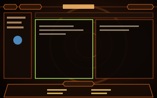
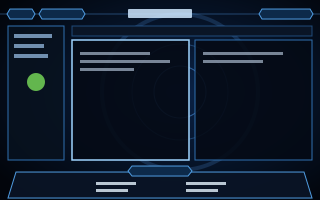
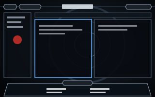

# herdr-always-need-mass-effect

[English](README.md) | Français

Trois layouts pour l'application Herdr (`~/.config/herdr-app`), un par jeu
Mass Effect, chacun avec son thème et une police type Eurostile :

| Layout | Style |
|---|---|
| `mission-computer` | le menu de pause de Mass Effect 2 (l'ordinateur de mission) : plaques ambrées à bouts pointus, fond sombre avec des anneaux holographiques |
| `normandy-sr1` | les menus de Mass Effect 1 : plaques bleues à coins coupés, fond de console bleu nuit |
| `war-room` | l'ordinateur de mission de Mass Effect 3 : plaques acier à bouts biseautés et bords argentés, fond acier sombre |

Les plaques `ME1` / `ME2` / `ME3` de la barre de titre, à côté de l'heure,
passent de l'un à l'autre ; celle du jeu affiché est allumée. La suite
décrit `mission-computer` ; les deux autres ont les mêmes zones, dans leurs
couleurs.

  

## Ce qu'on voit

| Zone | Contenu |
|---|---|
| en haut (`me-hud`, rôle `title`) | bouton de la barre latérale, `Rechercher` (sélecteur de Herdr), la Normandy (sessions Claude), le nom de l'espace affiché en titre avec sa branche et son nombre d'onglets, la bascule `ME1` / `ME2` / `ME3`, l'heure |
| à gauche | les espaces, les agents et le pied de la barre latérale de Herdr, dans un cadre ambré |
| au centre | les onglets, puis les volets : cadre ambré, cadre vert pour le volet qui a le clavier (comme la cible de l'écran de piratage) |
| en bas (`me-hud`, rôle `resources`) | le panneau « Ressources » : agents au travail, en attente, terminés, au repos ; usage de Claude Code (session, semaine) ; nombre d'espaces et d'onglets. Un clic sur « En attente » affiche l'agent qui attend |

La barre latérale, les onglets, les en-têtes des volets et les notifications
sont les mods de Herdr ; seuls la barre de titre et le panneau du bas sont
dessinés par `me-hud`, la fenêtre des sessions par `me-sessions`.

**L'usage de Claude Code** est lu dans `~/.cache/usage-cat/state.json`, que
remplit la status line de herdr-always-need-cats,
herdr-always-need-archives ou we-always-need-cats. Sans elle, le panneau
affiche `--`.

## Les sessions Claude

Le bouton Normandy de la barre de titre, ou `ctrl-shift-j`, ouvre la liste de
toutes les sessions Claude Code enregistrées sur la machine
(`~/.claude/projects`), de la plus récente à la plus ancienne. Chaque ligne
donne le titre de la session (le nom donné par `/rename`, sinon le titre
choisi par Claude Code, sinon la première demande), son projet, sa branche,
le nombre de demandes, la dernière demande et sa date.

- Taper filtre la liste (titre, projet, dossier, branche, demandes ; tous les
  mots doivent apparaître).
- Haut, bas, page haut, page bas pour choisir ; Entrée ou clic pour ouvrir ;
  Echap pour fermer.
- Clic droit : menu (reprendre ou afficher, supprimer). La suppression
  demande confirmation et met la session à la corbeille, avec son historique
  de fichiers ; une session ouverte ne peut pas être supprimée.

| Session | Entrée ou clic |
|---|---|
| fermée | la reprend (`claude --resume <id>`) dans un nouvel onglet, dans l'espace Herdr qui a un terminal dans son dossier, sinon dans un nouvel espace |
| ouverte dans Herdr (étiquette « ouverte ») | affiche son agent |
| ouverte hors de Herdr (autre terminal, IDE) | rien : la reprendre ferait deux sessions sur le même historique |

Les fichiers de session pèsent parfois plusieurs Mo : ce qui en est tiré est
gardé dans `~/.cache/herdr-always-need-mass-effect/sessions.json`, et un
fichier n'est relu que si sa taille ou sa date a changé.

## Installation

```bash
python3 install.py            # textes en français
python3 install.py --lang en  # textes en anglais
python3 install.py --style me1  # affiche normandy-sr1 (me2 : mission-computer, me3 : war-room)
```

Prérequis : Herdr, Python 3.9+. Pillow n'est utile que pour régénérer le
fond.

Le script relie les mods `me-hud` et `me-sessions` dans
`~/.config/herdr-app/mods`, copie chaque thème en
`~/.config/herdr-app/themes/<layout>.json`, écrit
`~/.config/herdr-app/layouts/<layout>.json` pour les trois layouts et en
affiche un : celui donné par `--style`, sinon celui déjà affiché, sinon
`mission-computer`. Il lie `ctrl-shift-j` aux sessions Claude dans la
section `layout:<layout>` de `~/.config/herdr-app/keys.json`, si la touche y
est libre. `ctrl-shift-l` fait défiler tous les layouts de Herdr.

Les layouts sont générés par `install.py` (fonction `layout()`, couleurs
dans `STYLES`) et réécrits à chaque installation : les modifier là, puis
relancer le script.

## Désinstallation

```bash
python3 install.py --uninstall
```

## Fichiers

| Chemin | Rôle |
|---|---|
| `install.py` | installation, et le layout lui-même (`layout()`) |
| `me-hud/main.js` | barre de titre et panneau « Ressources » |
| `me-sessions/main.js` | fenêtre des sessions Claude |
| `me-sessions/sessions.py` | lecture des sessions (avec cache), suppression |
| `me-sessions/normandy.svg` | le picto de la Normandy |
| `me-hud/theme.json`, `theme-me1.json`, `theme-me3.json` | les thèmes (couleurs du terminal et des mods) de `mission-computer`, `normandy-sr1` et `war-room` |
| `me-hud/img/bg.png`, `bg-me1.png`, `bg-me3.png` | les fonds, générés par `me-hud/tools/make_art.py` |
| `me-hud/preview.svg`, `preview-me1.svg`, `preview-me3.svg` | les aperçus montrés dans les réglages de Herdr |
| `me-hud/fonts/` | Michroma (titres, chiffres) et Chakra Petch (texte) |

## Licence

MIT (voir `LICENSE`), sauf les polices de `me-hud/fonts/` : SIL Open Font
License 1.1 (licences à côté).

Mass Effect est une marque d'Electronic Arts et BioWare ; ce projet est un
hommage de fan, sans lien avec eux. Les fonds et les dessins sont originaux.
