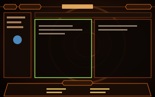
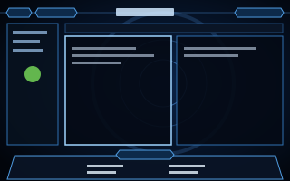
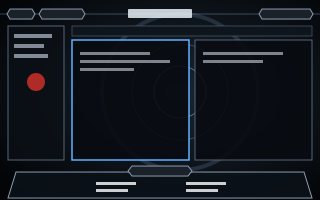

# herdr-always-need-mass-effect

English | [Français](README.fr.md)

Three layouts for the Herdr app (`~/.config/herdr-app`), one per Mass Effect
game, each with its own theme and a Eurostile-like font:

| Layout | Style |
|---|---|
| `mission-computer` | the Mass Effect 2 pause menu (the mission computer): amber plates with pointed ends, a dark background with holographic rings |
| `normandy-sr1` | the Mass Effect 1 menus: blue plates with cut corners, a deep blue console background |
| `war-room` | the Mass Effect 3 mission computer: steel plates with slanted ends and silver edges, a dark steel background |

The `ME1` / `ME2` / `ME3` plates of the title bar, next to the clock,
switch between them; the shown game's plate is lit. What follows describes
`mission-computer`; the other two have the same areas, in their colors.

  

## What you see

| Area | Content |
|---|---|
| top (`me-hud`, role `title`) | sidebar button, `Search` (Herdr's picker), the Normandy (Claude sessions), the shown space's name as the title with its branch and tab count, the `ME1` / `ME2` / `ME3` switch, the time |
| left | Herdr's spaces, agents and sidebar footer, in an amber frame |
| centre | tabs, then panes: amber frame, green frame for the pane with the keyboard (like the hacking screen's target) |
| bottom (`me-hud`, role `resources`) | the "Resources" panel: agents working, waiting, done, idle; Claude Code usage (session, week); number of spaces and tabs. Clicking "Waiting" shows the waiting agent |

The sidebar, tabs, pane headers and notifications are Herdr's own mods; only
the title bar and the bottom panel are drawn by `me-hud`, the sessions
window by `me-sessions`.

**Claude Code usage** is read from `~/.cache/usage-cat/state.json`, written
by the status line of herdr-always-need-cats, herdr-always-need-archives
or we-always-need-cats. Without it the panel shows `--`.

## Claude sessions

The Normandy button of the title bar, or `ctrl-shift-j`, opens the list of
every Claude Code session saved on the machine (`~/.claude/projects`), from
newest to oldest. Each row gives the session's title (the name given by
`/rename`, otherwise the title chosen by Claude Code, otherwise the first
prompt), its project, its branch, the number of prompts, the last prompt and
its date.

- Typing filters the list (title, project, folder, branch, prompts; every
  word must appear).
- Up, down, page up, page down to choose; Enter or click to open; Escape to
  close.
- Right-click: menu (resume or show, delete). Deleting asks for
  confirmation and moves the session to the trash, with its file history;
  an open session cannot be deleted.

| Session | Enter or click |
|---|---|
| closed | resumes it (`claude --resume <id>`) in a new tab, in the Herdr space that has a terminal in its folder, otherwise in a new space |
| open in Herdr ("open" label) | shows its agent |
| open outside Herdr (other terminal, IDE) | nothing: resuming it would make two sessions on the same history |

Session files are sometimes several MB: what is taken from them is kept in
`~/.cache/herdr-always-need-mass-effect/sessions.json`, and a file is only
read again when its size or date has changed.

## Install

```bash
python3 install.py            # French texts
python3 install.py --lang en  # English texts
python3 install.py --style me1  # show normandy-sr1 (me2: mission-computer, me3: war-room)
```

Requirements: Herdr, Python 3.9+. Pillow is only needed to regenerate the
background.

The script links the `me-hud` and `me-sessions` mods into
`~/.config/herdr-app/mods`, copies each theme to
`~/.config/herdr-app/themes/<layout>.json`, writes
`~/.config/herdr-app/layouts/<layout>.json` for the three layouts and shows one:
the one given by `--style`, otherwise the one already shown, otherwise
`mission-computer`. It binds `ctrl-shift-j` to the Claude sessions in the
`layout:<layout>` section of `~/.config/herdr-app/keys.json`, if the key is
free there. `ctrl-shift-l` goes through every Herdr layout.

The layouts are generated by `install.py` (`layout()`, colors in `STYLES`)
and rewritten on every install: change them there, then run the script
again.

## Uninstall

```bash
python3 install.py --uninstall
```

## Files

| Path | Role |
|---|---|
| `install.py` | install, and the layout itself (`layout()`) |
| `me-hud/main.js` | title bar and "Resources" panel |
| `me-sessions/main.js` | the Claude sessions window |
| `me-sessions/sessions.py` | reads the sessions (with a cache), deletes one |
| `me-sessions/normandy.svg` | the Normandy icon |
| `me-hud/theme.json`, `theme-me1.json`, `theme-me3.json` | the themes (terminal and mod colors) of `mission-computer`, `normandy-sr1` and `war-room` |
| `me-hud/img/bg.png`, `bg-me1.png`, `bg-me3.png` | the backgrounds, drawn by `me-hud/tools/make_art.py` |
| `me-hud/preview.svg`, `preview-me1.svg`, `preview-me3.svg` | the previews shown in Herdr's settings |
| `me-hud/fonts/` | Michroma (titles, figures) and Chakra Petch (text) |

## License

MIT (see `LICENSE`), except the fonts in `me-hud/fonts/`: SIL Open Font
License 1.1 (licenses alongside).

Mass Effect is a trademark of Electronic Arts and BioWare; this project is a
fan tribute, not affiliated with them. The backgrounds and drawings are
original.
